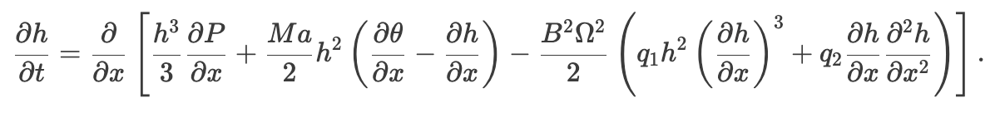
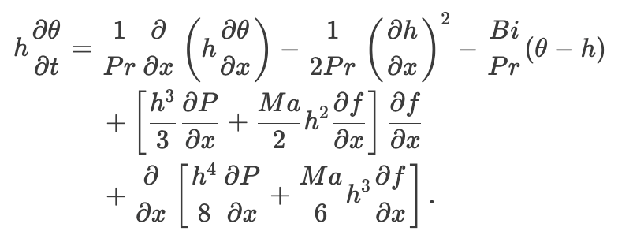
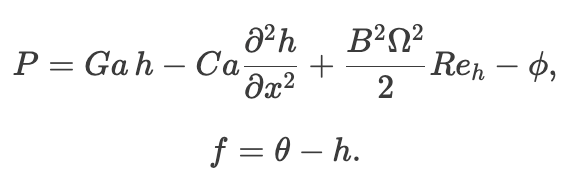

# Thin Film Explicit Scheme

A C++ implementation of an explicit finite difference scheme for simulating thermocapillary convection in a thin liquid film under vertical vibrations.

The solver describes the coupled evolution of the free surface and temperature field using a system of nonlinear evolution equations derived within the long-wave approximation and averaging approach.

The implemented system accounts for gravitational, capillary, vibrational, and thermocapillary effects, as well as heat transfer.

## Governing Equations

The model is described by a coupled system of evolution equations for the film thickness $h(x,t)$ and the temperature field $\theta(x,t)$.

### Film thickness evolution

<p align="center">
  
</p>

### Temperature evolution

<p align="center">
  
</p>

The auxiliary functions are defined as

<p align="center">
  
</p>

Here, $Ga$, $Ca$, $Ma$, $Bi$, and $Pr$ are dimensionless model parameters. The functions $Re_h$, $q_1$, $q_2$, and $\phi$ represent additional terms of the averaged model.

Periodic boundary conditions are applied in the horizontal direction.

## Numerical Method

The coupled system is solved using an explicit time-stepping scheme with finite difference approximations for spatial derivatives.

The system is stiff, which makes its numerical integration challenging and motivates the use of implicit time integration methods.

An alternative implementation of the same system using the **Radau IIA** method is available in:

[stiff_eqs_solver](https://github.com/ivanwolodin/stiff_eqs_solver)

## Project Structure

```text
.
├── constants.h
├── diff_operators.h
├── film_plotter.py
├── film_plotter_with_heat.py
├── main.cpp
├── output.h
├── surface_calculation.h
├── temperature_calculation.h
└── utility_functions.h
```

## Visualization

The repository includes Python scripts for visualizing the numerical results:

- `film_plotter.py` — visualization of film surface dynamics.
- `film_plotter_with_heat.py` — visualization of film dynamics and temperature distribution.

## Publications

The governing equations implemented in this project originate from the following research.

1. **I. Volodin and A. Alabuzhev**, "Linear Stability of Marangoni Convection in a Thin Film under Vertical Vibrations", *Microgravity Science and Technology*, **37**, 48 (2025).

   [https://doi.org/10.1007/s12217-025-10201-8](https://doi.org/10.1007/s12217-025-10201-8)

2. **I. Volodin and A. Alabuzhev**, "Averaged Dynamics of Marangoni Convection in a Thin Liquid Film Under Vertical Vibrations", *Microgravity Science and Technology*, **38**, 70 (2026).

   [https://doi.org/10.1007/s12217-026-10289-6](https://doi.org/10.1007/s12217-026-10289-6)

The first paper presents the linear stability analysis of the system, while the second investigates its nonlinear averaged dynamics.

## Related Projects

- [stiff_eqs_solver](https://github.com/ivanwolodin/stiff_eqs_solver) — an alternative solver for the same system of equations using the implicit Radau method.
- [thin_film_lbm_solver](https://github.com/ivanwolodin/thin_film_lbm_solver) — a separate Lattice Boltzmann implementation for thin-film hydrodynamics. It solves a different mathematical model.
- [PhD Thesis](https://github.com/ivanwolodin/thesis) — related research and thesis materials.